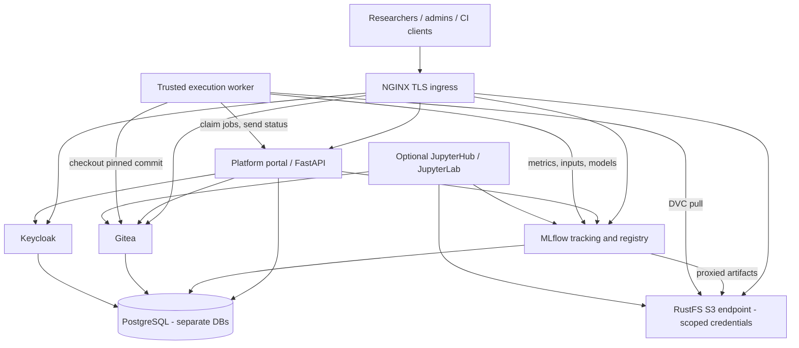

# AGENTS.md — Self-hosted MLOps platform

## 1. Mission

Build a working, maintainable MLOps platform for internal machine-learning research, training, evaluation and model delivery. MLflow and RustFS are mandatory. Prefer integrating existing open-source software over reproducing its functionality. The final system must run on an isolated Linux server or internal network without access to public cloud services or the internet.

This document is the implementation contract for coding agents. Produce actual working code, deployment manifests, automated tests and documentation, not just an architectural proposal. Implement incrementally and demonstrate a complete training-to-registry workflow before adding secondary capabilities.

### Scope and assumptions

- Target: a small internal AI engineering team, initially on a single Linux host with Docker Engine and Docker Compose v2; support CPU and optionally NVIDIA GPUs on trusted training hosts.
- Support multiple users and projects with enforceable access controls, not just a login screen.
- Provide a unified internal web portal, while retaining native component UIs and APIs.
- Support computer vision and conventional ML without coupling the platform to a particular model family.
- Preserve traceability across dataset versions, source revisions, training runs, artifacts and registered model versions.
- The deployment must be self-hosted and air-gap capable. Internet access may be used only in an explicitly authorized dependency-preparation environment.
- Do not implement data annotation, a feature store, Kubernetes, distributed training, inference orchestration or a custom model registry in the first release. These are possible extensions.
- Single-host deployment is not high availability. Treat hardening, backup and tested recovery as required; do not claim HA.

## 2. Agent operating rules

1. Inspect the repository, existing deployment manifests and available hardware before modifying anything. Preserve existing user changes. If empty, scaffold the structure below.
2. Write `docs/implementation-plan.md` with a concise milestone plan and `docs/adr/` with important architectural decisions. Record actual versions and known limitations.
3. Check upstream release documentation and compatibility. Do not use moving `latest` tags, unpinned Git branches, invented configuration flags or undocumented private APIs. Pin image versions/digests and Python/Node dependencies. Prefer supported stable releases; if RustFS or a required integration is pre-release, record that explicitly and test the exact release. Never silently substitute MinIO for RustFS.
4. Reuse the official MLflow Compose example as a reference, not as a secure production configuration. Keep custom code separate from vendor code; avoid forks unless documented evidence shows no reasonable alternative.
5. Implement one milestone at a time; run tests and inspect actual service logs. Fix regressions before continuing. Keep the repository runnable after each completed milestone.
6. Never commit real passwords, tokens, certificates, private keys, datasets or model weights. Use generated local secret files, supported secret mounts and ignored local configuration. Mask secrets in logs and errors.
7. Do not destroy persisted data, reset accounts, change production firewall rules, prune volumes or install host drivers without explicit approval. Never use `docker compose down -v` as a routine fix.
8. Use least privilege. Do not grant the public API or web frontend access to the Docker socket. Do not claim isolation based solely on UI restrictions. Treat training code, model deserialization and notebooks as potentially unsafe.
9. If something cannot be executed in the available environment (e.g., no Docker daemon or GPU), document the exact missing prerequisite, retain reproducible test commands, and mark the test NOT RUN. Never fabricate results.
10. Keep the implementation simple, typed where appropriate, and covered by tests. Do not add microservices, infrastructure or features just because they are fashionable.

## 3. Technology choices

| Capability | Component | Phase |
|---|---|---|
| Experiment tracking and artifact proxy | MLflow Tracking Server | Core |
| Model registry, versions and aliases | MLflow Model Registry | Core |
| Object storage | RustFS (S3-compatible) | Core |
| Metadata | PostgreSQL | Core |
| Dataset versioning | DVC with S3 remote on RustFS | Core |
| Git hosting | Gitea (or existing internal Git service) | Core |
| Identity provider | Keycloak | Team |
| Ingress and TLS | NGINX | Team |
| Web portal and orchestration metadata | React + TypeScript, FastAPI + SQLAlchemy/Alembic | Team |
| Interactive research | JupyterLab, preferably launched via JupyterHub for shared use | Extension |
| Job execution | Isolated worker service + Docker on a dedicated trusted execution host | Team |
| Metrics/dashboard | Prometheus and Grafana | Optional |
| CI | Existing internal CI or Gitea Actions with isolated runner | Extension |

Use PostgreSQL as a shared engine initially but create distinct databases and restricted roles for MLflow tracking, MLflow auth if applicable, Gitea, Keycloak, and portal. Never manipulate MLflow's database schema from portal code. Use the supported MLflow API and SDK instead.

## 4. Architecture



Only ingress and explicitly approved service endpoints are reachable from the internal user network. Separate ingress, control-plane, storage/database and execution networks. Define explicit permitted flows and verify that direct backend access cannot bypass auth. A Compose network alone is not a hardened multi-tenant isolation boundary.

### Sources of truth

- Keycloak owns identities and central group membership; component-level policies enforce access.
- Git owns source history and DVC pointer files.
- DVC owns content-addressed dataset snapshots; RustFS stores bytes.
- MLflow owns experiments, runs, metrics, logged models and registry records.
- PostgreSQL portal DB owns project mapping, dataset catalog/index, job queue/state, approval records and portal audit events only.
- Portal aggregates these records with identifiers and links; it must not replicate the authoritative model registry, metric store or Git history.

## 5. Core deployment

### 5.1 Docker Compose

Create `compose.yaml` and profile/override files as needed. The `core` deployment must start PostgreSQL, RustFS, an idempotent storage/database bootstrap process, MLflow and Git hosting (or documented external internal Git configuration). The full `team` deployment adds Keycloak, ingress, portal and worker connectivity. Optional services must not be required for the core smoke test.

Use named persistent volumes or documented host mount points, health checks, readiness-aware bootstrap with bounded retries, restart policies for long-running services, and appropriate resource limits. Do not expose database or unauthenticated internal MLflow ports. A development-only loopback mode may be available; clearly label it as single-user and not suitable for shared access. Store durable data outside containers and test restart persistence.

Use separate internal DNS/service endpoints and user-facing TLS endpoints; use environment-specific configuration rather than hardcoded `localhost` inside containers. Use an internal CA and distribute the trust chain to CLI tools and containers. Preserve required forwarded host/protocol headers; configure MLflow allowed hosts/CORS and security settings according to the pinned release. Never globally disable TLS verification to make a test pass.

### 5.2 RustFS

Provision these logical buckets (or per-project buckets when isolation demands it):

| Bucket | Purpose | Access |
|---|---|---|
| `mlflow-artifacts` | Run artifacts, checkpoints, logged models | MLflow server only (normal workflow) |
| `ml-datasets` | DVC content-addressed objects under project-specific namespaces | Project-scoped users and training identities |
| `ml-exports` | Explicitly approved delivery packages and reports | Project-scoped access |
| `ml-ingest` | Optional temporary inbound data | Scoped upload/read permissions |

Use a restricted bootstrap/admin credential to create buckets and policies. Do not distribute the RustFS root key to researchers, jobs, portal or MLflow. Configure separate scoped service credentials and test the real IAM behavior of the selected release, including list-prefix and object-level operations, multipart uploads and cross-project denial. If prefix enforcement is incomplete, switch to per-project buckets or a stronger isolated deployment. Do not release a shared deployment with unrestricted dataset credentials.

Use RustFS internal S3 API (typically `http://rustfs:9000`) from trusted containers; use a separately configured TLS endpoint from external SDKs. Console (typically port 9001) is admin-only unless scoped console access is explicitly verified. Test S3 signature compatibility, addressing style, list/get/put, multipart transfer, and persisted data after restart. Enable object versioning or other protection where supported and useful; do not treat it as a replacement for DVC or backups. Do not enable destructive object cleanup by default.

### 5.3 MLflow

Build a pinned server image if extra drivers, auth packages or S3 dependencies are required. Install the matching PostgreSQL driver and boto3. Configure a SQL-backed tracking store, server-side artifact proxy and RustFS artifact destination. Illustrative command (verify against the selected version and inject secrets securely):

```bash
mlflow server \
  --host 0.0.0.0 \
  --port 5000 \
  --backend-store-uri "$MLFLOW_BACKEND_STORE_URI" \
  --serve-artifacts \
  --artifacts-destination s3://mlflow-artifacts
```

Set `MLFLOW_S3_ENDPOINT_URL` to the RustFS service endpoint and inject scoped `AWS_ACCESS_KEY_ID`, `AWS_SECRET_ACCESS_KEY`, region and necessary addressing configuration into the server, not normal tracking clients. Test uploads/downloads through MLflow. Create new experiments using the proxy-backed artifact root for this setup; existing experiments may retain prior artifact locations. Do not confuse `--artifacts-destination` with a direct client-side S3 artifact root.

Clients use `MLFLOW_TRACKING_URI` pointing at the authenticated tracking endpoint, and supported auth configuration. Use registry aliases (e.g. `candidate`, `champion`) and tags rather than deprecated fixed stage transitions. Log models with appropriate flavor, signature, input example and reproducible environment requirements. Preserve source run and model IDs using actual API fields. Never assume all versions of the SDK use the same model URI shape.

Configure DB migrations deliberately. Back up first, run supported schema upgrade commands when needed, and test upgrades in a separate environment. Do not manually patch vendor tables.

## 6. Identity and authorization

Do not equate central authentication with resource authorization. Enforce both for browser requests, SDKs, CLI operations and direct service APIs. A shared reverse-proxy login alone is insufficient to isolate MLflow projects.

### Roles

| Role | Permissions |
|---|---|
| Platform admin | Manage identities, projects, infrastructure and policies; audited |
| Project maintainer | Manage project members, datasets, jobs, experiments and approved promotion workflow |
| Researcher | Read approved project data, create dataset versions, submit jobs and log models/experiments in assigned projects |
| Viewer | Read assigned project metadata, runs, artifacts and approved models; no writes |
| Service identity | Only the specific machine permissions needed for its project/job/service |

Implement project-level deny-by-default access; users not in a project must not be able to list or retrieve its data. Treat global administrators as trusted. Specify whether model promotion is allowed by maintainers or a distinct reviewer role; default to maintainer approval with audit.

### Implementation and release gate

- Keycloak: configure a local realm, roles/groups, individual browser login and OIDC clients. Use Authorization Code + PKCE for the browser and narrowly scoped service/client credentials or another supported noninteractive flow for SDKs. Validate token signature, issuer, audience, expiry and authorization at FastAPI. Avoid browser persistent token storage; prefer secure, HttpOnly session cookies with CSRF protection if using a backend-for-frontend. Disable self-registration by default. Provide a repeatable realm bootstrap with no embedded secrets.
- Gitea: integrate with Keycloak using supported OAuth/OIDC, map project permissions explicitly and verify revocation. Git SSH/HTTPS credentials follow the selected service's native security model.
- MLflow: first evaluate the selected MLflow release's native workspaces, roles and permissions, then supported OIDC auth plugin compatibility. Prefer an integration that authenticates the browser and SDK and enforces native resource permissions. Do not assume workspace support or group synchronization is available with every plugin/release. If unified OIDC cannot be made safe, use MLflow's native basic-auth/RBAC with separate per-user/service credentials and an explicit provisioning/synchronization procedure as the temporary fallback; document that it is not full SSO. Use an auth database on PostgreSQL where the chosen mode supports it; replace initial admin secrets immediately. Configure default permissions to deny unauthorized access. If resource-level isolation is not reliable, use separate MLflow instances per trust boundary or do not ship shared access.
- RustFS: prefer project-specific scoped keys or tested STS/OIDC flows. Use service credentials for DVC and training, not browser bearer tokens passed blindly to S3. If using RustFS OIDC, verify the release's group-to-policy mapping, token exchange and credential expiry. Reserve root credentials for administration.
- Ingress: prevent direct backend bypass, strip spoofable client identity headers, forward only trusted headers, configure TLS and appropriate upload timeouts/limits, and ensure service routes do not redirect noninteractive clients to HTML login pages.
- Portal: enforce object-level permissions on every endpoint, including IDs supplied by the client. Never proxy arbitrary upstream URLs or grant a broad backend service identity's permissions to all users. Prefer delegated/scoped credentials; carefully authorize any privileged mediation. Audit all project membership and role changes.
- Test user removal and credential rotation. Reconcile role changes across all systems; document token/session revocation latency and invalidate access as supported.

Do not declare the team deployment complete until two independent project users and a viewer have been tested against direct APIs and storage access. Test known run/model/object IDs, artifact endpoints, searches/listing, Git repos and DVC objects. A successful portal login alone does not pass this gate.

## 7. Dataset versioning and lineage

Use DVC with the `dvc[s3]` dependency and Git. Each project owns a Git repository (a separate data repository is permitted) and an isolated DVC remote. A minimal configuration looks like:

```bash
dvc init
dvc remote add -d storage s3://ml-datasets/<project-id>/dvc
dvc remote modify storage endpointurl https://s3.mlops.internal
# Credentials are injected externally, never committed to .dvc/config.
dvc add data/train.csv
git add .dvc .gitignore data/train.csv.dvc
dvc push
git commit -m 'Version training dataset'
```

Adjust initialization and Git paths for actual repo structure. Push the commit to internal Git only after its DVC objects are present. A dataset version is the immutable combination of a Git commit, DVC pointer/lock hash, and a verified manifest; it is not a mutable S3 path or display label. Use commit SHAs (not branch names) in training jobs. Record hash algorithm and digest; do not confuse S3 ETag with SHA-256 or DVC content hash. `dvc gc` is not part of normal operations and requires a reviewed retention policy.

Implement a small dataset catalog in the portal, indexing versions rather than storing duplicate data. Support publishing a version from a trusted repository revision, browsing metadata and obtaining checkout instructions. Initial ingestion may be CLI-driven. No need to implement a full browser-based dataset editor.

Suggested immutable dataset metadata:

```json
{
  "project_id": "vision-demo",
  "dataset_id": "person-detection",
  "version_id": "generated-immutable-id",
  "git_repository": "internal repository identifier",
  "git_commit": "full commit SHA",
  "dvc_path": "data/train.dvc",
  "dvc_hash": {"algorithm": "md5", "value": "actual DVC hash"},
  "manifest_sha256": "actual manifest SHA-256",
  "remote_uri": "s3://ml-datasets/vision-demo/dvc",
  "splits": ["train", "val", "test"],
  "sample_count": 0,
  "schema_version": 1
}
```

This JSON is a schema illustration; no fabricated digests/counts in real records. Require validation of dataset existence and integrity before marking a version ready. Store timestamps and creator separately. Include optional annotation format, license, class list and provenance metadata. Store manifests and avoid logging sensitive sample content or personal information unnecessarily.

Training jobs must log actual dataset inputs with `mlflow.log_input()` and an appropriate MLflow Dataset abstraction, context (`training`, `validation`, `test`), plus tags or a lineage artifact containing the full external dataset version reference. MLflow dataset tracking alone does not materialize or guarantee reproducible datasets. Ensure the portal can navigate the lineage:

`Git commit + DVC version -> training job -> MLflow run -> logged model -> registered version -> alias/approval`

Record environment lockfile checksum, image digest, source commit, random seed, hyperparameters, job ID, hardware/runtime metadata, dataset manifests, metrics and output identifiers. Keep lineage references immutable even if aliases change. Where determinism is not guaranteed (e.g., GPU kernels), document it.

## 8. Training execution

Build a small, durable job orchestration layer only after the native MLflow workflow is working. Do not run training in the FastAPI process. Do not require an external cloud runner, Celery or Kubernetes for the initial queue; PostgreSQL-backed claiming with row locks/leases is sufficient for small scale.

### Job contract

- Submit an authenticated project-scoped request containing a registered repository ID, immutable source commit, published dataset version(s), allowlisted training image digest, entrypoint/argument list, CPU/memory/GPU requirements, timeout, and experiment/model settings.
- Validate access, quotas and resource requests; accept only approved internal repositories, artifact locations and image registries. Do not interpret arbitrary shell commands in the control plane.
- Persist states `QUEUED`, `RUNNING`, `SUCCEEDED`, `FAILED`, `CANCEL_REQUESTED`, `CANCELLED`, and attempt/lease metadata. Use transactional state transitions and job/attempt IDs to prevent duplicate execution on normal retries. Document reconciliation after a worker crash; uncertain outcomes require investigation rather than blind reruns.
- Worker polls a scoped API, claims an available job atomically, checks out the exact commit, retrieves DVC data and validates digests, starts a fresh container, streams bounded logs, reports heartbeats and captures exit status. A retry uses a distinct attempt and MLflow run; retain the failure record.
- Support CPU first. For NVIDIA hosts, add GPU scheduling and container runtime validation. Keep GPU capacity configuration explicit; do not promise GPU support without a real smoke test.
- Capture logs, run IDs, start/end timestamps, selected device and failure reasons. Cancellation and timeout must stop the container, release resources and leave a terminal audit record. Use bounded retries and explicit cleanup of job-owned scratch directories only.

### Execution security

Use a dedicated trusted execution host or isolated VM for workers; the Docker daemon is effectively root-equivalent. The control plane never receives a Docker socket. The worker alone invokes a restricted launcher via validated structured arguments. Do not allow privileged jobs, host networking, arbitrary host mounts, Docker socket access inside jobs, arbitrary images, or inherited administrative credentials. Run jobs as non-root where supported, with dropped capabilities, resource limits and appropriate security profiles. Give each job only its own scoped project credentials and limited network access to required endpoints; use short-lived credentials where supported. Keep immutable dataset inputs read-only and outputs in job-owned paths.

This MVP runs trusted internal code. Docker containers sharing a kernel are not sufficient for mutually hostile tenants; use VM-level isolation or a hardened runtime and separate hosts for untrusted code. Do not claim such isolation for the initial release.

## 9. Unified web application

Create a small React + TypeScript UI and FastAPI backend, using SQLAlchemy and Alembic for portal-owned data. Reuse native MLflow and Gitea views via authenticated links rather than rebuilding them or embedding unprotected iframes. Prioritize functional flows over visual complexity. All assets/fonts must be locally bundled; no CDN dependencies.

Required pages:

| Page | Function |
|---|---|
| Login / account | Central login, identity and project membership |
| Dashboard | Health of core services, project counts, recent jobs and runs |
| Projects | Create/manage projects, memberships and native component links |
| Datasets | Version catalog, manifest/metadata, Git and DVC references |
| Experiments | Project-scoped run overview and deep links to MLflow |
| Models | Registry overview, lineage, versions, aliases and promotion approval |
| Jobs | Submit configured jobs, observe status/logs, cancel and retry |
| Administration | Authorized role/project management, audit events and health |

Required API groups (versioned under `/api/v1`): `/projects`, `/datasets`, `/jobs`, `/models`, `/audit`, `/health` and worker-only claim/heartbeat/complete endpoints. Specify OpenAPI schemas, pagination, validation, consistent errors and authorization tests. Health endpoints must not disclose secrets. Store external IDs and audit events, never duplicate full MLflow runs. Use bounded upstream timeouts and graceful degradation; do not label inaccessible data as empty.

Model promotion: require a successful evaluation run and project-defined validation checks before portal approval. Record reviewer, model version, metrics, criteria and time, then set an alias through MLflow API. Account for failures between DB and MLflow changes with reconciliation. Rollback reassigns the alias to an approved prior immutable version. Direct MLflow permissions must prevent unauthorized alias changes; if the native release cannot enforce the exact approval workflow, explicitly restrict alias-writing to an authorized promotion identity or document the trusted-maintainer bypass. Do not claim technical approval enforcement when only UI checks exist.

## 10. Optional extensions

- JupyterHub with separate users/workspaces and resource quotas; launch JupyterLab sessions with scoped project credentials and persistent home directories. Do not expose a shared notebook with token authentication disabled. Allow local IDE/VS Code clients as an alternative.
- Prometheus/Grafana: collect supported service and host metrics, storage capacity, job queue depth and failures. Avoid exposing sensitive metrics or inventing exporter capabilities. Include alert examples for disk capacity, failed backups, unhealthy services and stalled jobs.
- Internal Git CI: test/lint, build reproducible training images, record image digests and submit jobs using scoped credentials. Avoid privileged runners for arbitrary repositories.
- Future: CVAT/Label Studio, pipeline orchestration (e.g., Prefect/Argo after evaluation), lakeFS if Git/DVC becomes inadequate for large object-native workflows, model serving, feature store, multi-node object storage and Kubernetes. None is needed to pass the core release. Evaluate each against real demand, operational cost and air-gap compatibility.

## 11. Offline deployment and security operations

Create a documented two-stage delivery flow: online preparation on an approved host, offline import and operation on the target.

1. Preparation: resolve exact image digests, fetch base images and OS packages, create a Python wheelhouse for the target architecture and Python ABI, vendor Node dependency cache or produce prebuilt frontend images, package model/runtime assets used by the demo, and record checksums, licenses, dependency manifests/SBOM where possible. Mirror source and build inputs to an internal repository. Run dependency and image scanning in the approved environment using an available vulnerability database; record its age.
2. Offline: verify checksums, load images into Docker or an internal registry, install dependencies from the local wheelhouse, and launch with pulls disabled. Use `docker compose up -d --pull never --no-build` for prebuilt images. For offline rebuilds, use explicitly prepared dependency sources and test separately. No package downloads, CDN assets, telemetry calls, external model downloads or cloud identity providers at runtime.
3. Configure internal DNS, CA certificates and time synchronization. Disable nonessential telemetry and update checks using release-supported settings. Enforce outbound network policy on the host/firewall or isolated network, not merely by configuration. Run a full smoke test with outbound internet blocked and record the result.
4. Provide secret generation/rotation instructions, service credential revocation, audit event retention, and safe log redaction. Keep secrets out of backup logs, job specs and Git. Use least-privilege OS ownership and protected storage.
5. Back up PostgreSQL databases, RustFS object data and policies/configuration, Git repos/LFS data, Keycloak configuration and portal state, plus required secrets/keys in separately protected backup storage. Preserve consistent references using quiesced writers or a documented coordinated backup procedure. Backups must reside outside the same failure domain. Document restore order and test a restore in a clean isolated deployment. Record measured recovery time and backup interval; do not claim HA or zero data loss.

## 12. Repository structure

```text
.
├── AGENTS.md
├── README.md
├── Makefile
├── compose.yaml
├── compose.team.yaml
├── compose.observability.yaml
├── .env.example
├── .gitignore
├── versions.lock.yaml
├── infra/
│   ├── mlflow/
│   ├── rustfs/
│   ├── postgres/
│   ├── keycloak/
│   ├── gitea/
│   ├── nginx/
│   └── monitoring/
├── apps/
│   ├── api/
│   └── web/
├── services/worker/
├── sdk/mlops_client/
├── examples/
│   └── sklearn-demo/
├── scripts/
│   ├── bootstrap/
│   ├── offline/
│   ├── backup/
│   └── smoke/
├── tests/
│   ├── unit/
│   ├── integration/
│   ├── security/
│   └── e2e/
└── docs/
    ├── architecture.md
    ├── implementation-plan.md
    ├── deployment.md
    ├── user-guide.md
    ├── security.md
    ├── offline.md
    ├── backup-restore.md
    ├── acceptance-report.md
    └── adr/
```

Adjust layout to existing conventions and document deviations. Provide lockfiles and migration scripts, a `.env.example` containing placeholders only, and a separate secrets initialization command. Do not commit runtime volumes or secrets.

Provide working Make targets (or equivalent documented scripts): `make init`, `make up`, `make up-team`, `make status`, `make logs`, `make smoke`, `make test`, `make demo`, `make backup`, `make restore-test`, `make offline-bundle`, and `make down`. Normal shutdown preserves volumes. Commands must fail with meaningful diagnostics and nonzero exit codes when checks fail. Separate destructive recovery commands from normal startup.

## 13. Implementation milestones

| Milestone | Deliverables | Exit criteria |
|---|---|---|
| M0: Compatibility | Version lock, ADRs, dependency matrix, topology | Verify MLflow/RustFS/S3 integration and identity options; record risks |
| M1: Core | PostgreSQL, RustFS, MLflow, internal Git, bootstrap | MLflow logs metrics and proxy artifacts; registers and retrieves a model; restart preserves state |
| M2: Reproducible data | DVC remote, sample repo, lineage SDK | Fresh checkout of exact version succeeds; one run links dataset, source and registered model |
| M3: Secure team deployment | Keycloak, ingress, component policies | Browser and API login work; cross-project and viewer denial tests pass; no bypass |
| M4: Portal | Project/dataset/run/model pages, audit and approval | Complete authorized browse and promotion flow with native links |
| M5: Training worker | Queue, job launcher, log/status/cancel workflow | CPU demo submitted via portal/API reaches registry; cancellation/failure tests pass |
| M6: Operational readiness | Offline bundle, backup/restore, test report | Air-gapped smoke test and clean restore succeed; limitations documented |

Complete M1-M2 before spending time on custom UI. If team authorization cannot be securely integrated, preserve working single-user core, report blockers, and do not enable unsafe shared access. Deliver optional features only after the mandatory milestones pass or the user explicitly reprioritizes them.

## 14. Mandatory end-to-end demo

Use a small deterministic synthetic dataset generated locally (no downloads) and a lightweight scikit-learn classifier or regressor that runs on CPU. Use an internal Git repository and DVC. Provide the actual example code and commands.

1. Create two users and projects (team mode); create an experiment and project-scoped storage policy.
2. Generate a dataset, commit its DVC pointer, upload objects and publish dataset version A.
3. Submit a job referencing the exact code SHA and version A; retrieve data into a clean workspace.
4. Train and evaluate; log parameters, metrics, dataset inputs, signature, environment metadata, an evaluation report and the model to MLflow.
5. Register model version 1 and verify model load/prediction in a clean environment. Assign `candidate`; approve `champion` using an authorized identity.
6. Change dataset content, publish version B, train again and register model version 2. Compare runs and verify both versions of data remain reproducible. Verify rollback of the alias to model version 1.
7. Inspect lineage from portal and native MLflow UI. Restart stack and repeat artifact retrieval, model loading and DVC checkout.
8. Repeat relevant checks with internet blocked. Run denied-access tests under different users and service identities. Do not give normal MLflow clients artifact-bucket credentials merely to make the demo work.

## 15. Acceptance tests and definition of done

Use automated assertions wherever practical. Record exact commands, selected versions, test outcomes (`PASS`, `FAIL`, `NOT RUN`) and logs/diagnostics in `docs/acceptance-report.md`. Do not mark a feature passed based only on a healthy container.

- Core: fresh initialization succeeds; repeated bootstrap is non-destructive; health checks correctly detect service failures; stop/start preserves MLflow runs, registry records, Git repos and RustFS objects.
- Storage: bucket/policy provisioning, scoped list/get/put, multipart upload/download, checksum round trip, cross-project denial; normal MLflow client can log/download artifacts without S3 secrets; direct S3 access to artifact bucket denied to that client.
- Data: two dataset versions can be retrieved by exact commit into empty cache/workspace; manifests and checksums match; failed/incomplete publishes are not marked ready; data lineage links both runs to their correct dataset versions.
- Model: registry create/version/get, model loading/prediction, aliases, authorized promotion and rollback; unauthorized mutation denied.
- IAM: anonymous, expired-token, incorrect-audience, viewer-write, cross-project, direct API/ID lookup, artifact URL, Git repo, S3 object and spoofed header denial; user/group revocation and machine access; no backend ingress bypass. Test any SSO fallback honestly.
- Job execution: queue claim race, success, failure, timeout, cancellation, worker disconnect/restart, duplicate-submit semantics and resource enforcement. Confirm no secrets in job logs. Verify GPU only on actual NVIDIA host; CPU is mandatory.
- Security: only approved ports published; no default passwords, broad service keys or embedded secrets; no Docker socket in portal or job containers; TLS trust valid; secrets redacted; dependencies pinned; no public network reliance.
- Operations: offline install from prepared bundle, complete demo with public network blocked, backup plus restore to a separate clean stack, restored model and both dataset versions usable.
- UI/API: all required project-scoped flows and responsive error/empty states, OpenAPI docs, permission enforcement at backend, and useful health/diagnostic outputs. Optional profiles can be disabled without breaking core.

Completion requires runnable code, documentation and evidence. Report unmet requirements and risk explicitly; never hide failures behind mocks. Do not represent the system as production-ready for hostile multi-tenant workloads or as highly available.

## 16. Upstream references and compatibility checks

Consult the official documentation for the exact pinned releases; the links below were selected on 2026-11-26 as starting points, not proof of compatibility for future releases. When operating offline, use a prepared local copy of required docs and source references.

- MLflow self-hosting: https://mlflow.org/docs/latest/self-hosting/
- Official MLflow + PostgreSQL + RustFS Compose reference: https://github.com/mlflow/mlflow/tree/master/docker-compose
- Tracking server and artifact proxy: https://mlflow.org/docs/latest/self-hosting/architecture/tracking-server/
- MLflow dataset inputs: https://mlflow.org/docs/latest/ml/dataset/
- Registry workflow: https://mlflow.org/docs/latest/ml/model-registry/workflow/
- MLflow SSO: https://mlflow.org/docs/latest/self-hosting/security/sso/
- MLflow basic authentication: https://mlflow.org/docs/latest/self-hosting/security/basic-http-auth/
- MLflow workspaces and permissions: https://mlflow.org/docs/latest/self-hosting/workspaces/permissions/
- RustFS installation: https://docs.rustfs.com/en/installation/container
- RustFS IAM: https://docs.rustfs.com/en/security-compliance/iam
- RustFS OIDC: https://docs.rustfs.com/en/security-compliance/oidc
- RustFS credentials: https://docs.rustfs.com/en/operations/credentials
- DVC S3-compatible remote: https://doc.dvc.org/user-guide/data-management/remote-storage/amazon-s3
- Keycloak proxy configuration: https://www.keycloak.org/server/reverseproxy

Start by implementing M0 and M1. Keep MLflow and RustFS as the center of the system, validate the core workflow, then build the platform around it.
