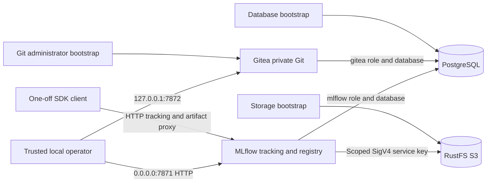

# MLflow core architecture

| Compose network | Services | Purpose |
| --- | --- | --- |
| `frontend` | MLflow, Gitea and one-off clients | Native tracking UI, SDK traffic and Git over HTTP |
| `database` (internal) | PostgreSQL, MLflow, Gitea and database/Git bootstrap | Metadata and database initialization |
| `storage` (internal) | RustFS, MLflow and one-off storage tools | S3 artifact traffic and storage initialization |

MLflow publishes port 7871 on all IPv4 interfaces and trusts callers who can connect. Its Host allowlist accepts localhost, the Compose service name and configured additional addresses. PostgreSQL and RustFS have no host port bindings. Gitea is loopback-only with SSH and self-registration disabled. The RustFS console is disabled. Team access remains subject to the M3 authentication and authorization gate.

PostgreSQL stores MLflow runs and registry records alongside a separate database for Gitea. Gitea stores Git objects in its own named volume. RustFS stores artifacts and its IAM state in its object data volume. The client receives `mlflow-artifacts:/` locations and reaches each artifact through MLflow. Proxy multipart offload stays disabled because the presigned URLs would require clients to reach the internal RustFS endpoint. S3 multipart between the server-side storage client and RustFS is tested independently.

| Logical bucket | M1 access |
| --- | --- |
| `mlflow-artifacts` | Scoped MLflow service identity can list, read, write and perform multipart operations |
| `ml-datasets` | Private and reserved for M2 project policies |
| `ml-exports` | Private and reserved for approved exports |

The image, bootstrap scripts and integration fixtures are local additions. Upstream application source is consumed through pinned packages and images. [Version lock](../versions.lock.yaml) · [Python lock](../infra/mlflow/requirements.lock)
