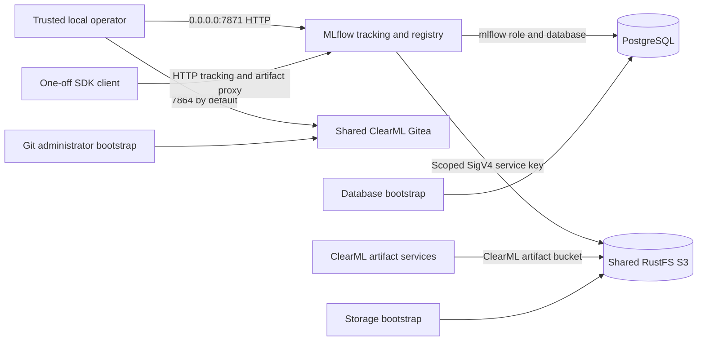

# MLflow core architecture

| Compose network | Services | Purpose |
| --- | --- | --- |
| `frontend` | MLflow and one-off clients | Native tracking UI and SDK traffic |
| `database` (internal) | PostgreSQL, MLflow and database bootstrap | Tracking and registry metadata |
| `mlops-artifacts` (internal) | RustFS, MLflow, ClearML artifact services and one-off storage tools | Shared S3 traffic and storage initialization |

MLflow publishes port 7871 on all IPv4 interfaces and trusts callers who can connect. Its Host allowlist accepts localhost, the Compose service name and configured additional addresses. PostgreSQL has no host port binding. Git hosting uses the existing ClearML Gitea and its configured HTTP endpoint. The shared RustFS deployment retains the original ClearML API and console ports. Team access remains subject to the M3 authentication and authorization gate.

PostgreSQL stores MLflow runs and registry records. Shared Gitea keeps its repositories and SQLite database under the existing ClearML data directory. RustFS stores both platforms’ artifacts and IAM state under the existing `RUSTFS_DATA_ROOT` bind mount. The client receives `mlflow-artifacts:/` locations and reaches each artifact through MLflow. Proxy multipart offload stays disabled because the presigned URLs would require clients to reach the internal RustFS endpoint. S3 multipart between the server-side storage client and RustFS is tested independently.

| Logical bucket | M1 access |
| --- | --- |
| `tonops-artifacts` | Existing ClearML bucket and credentials |
| `mlflow-artifacts` | Scoped MLflow service identity can list, read, write and perform multipart operations |
| `ml-datasets` | Private and reserved for M2 project policies |
| `ml-exports` | Private and reserved for approved exports |

The image, bootstrap scripts and integration fixtures are local additions. Upstream application source is consumed through pinned packages and images. [Version lock](../versions.lock.yaml) · [Python lock](../infra/mlflow/requirements.lock)
